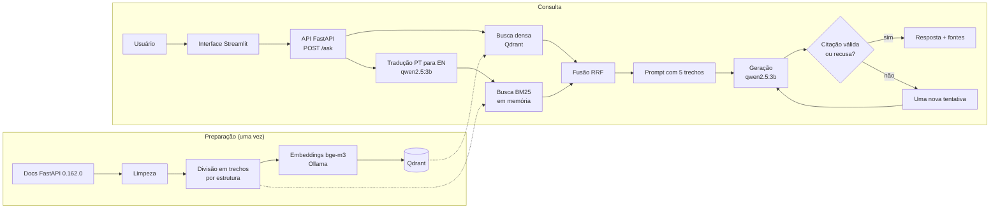

# 1. Visão geral e arquitetura

O sistema responde perguntas em português sobre a documentação do FastAPI 0.162.0 (em inglês), cita os trechos usados e recusa quando a resposta não está na documentação. Tudo roda localmente, sem chaves de API e sem custo.

## Componentes

| Componente | Código | Função |
| --- | --- | --- |
| Limpeza do corpus | `src/app/ingest/` | Baixa a documentação e transforma em texto limpo |
| Divisão em trechos | `src/app/rag/chunking.py` | Estratégias `fixed` (tamanho fixo) e `structure` (por títulos) |
| Embeddings e geração | `src/app/rag/ollama.py` | Fala com o Ollama (`bge-m3` e `qwen2.5:3b`) |
| Banco vetorial | `src/app/rag/qdrant.py`, `index.py` | Guarda e busca vetores no Qdrant |
| Busca por palavras | `src/app/rag/bm25.py` | BM25 em Python puro, na memória da API |
| Busca híbrida | `src/app/rag/retrieve.py` | Junta as duas buscas com RRF (k=60, 20 candidatos de cada) |
| Tradução | `src/app/rag/translate.py` | Traduz a pergunta só para a busca por palavras |
| Pipeline | `src/app/rag/pipeline.py` | Monta o prompt, gera, valida citações, recusa |
| API | `src/app/main.py` | `POST /ask`, `/health`, `/config` |
| Interface | `src/app/ui.py` | Tela Streamlit |
| Preparação automática | `src/app/setup.py` | Baixa modelos e corpus e cria o índice no primeiro uso |

## Fluxo de uma pergunta

1. O usuário escreve a pergunta na interface (ou chama `POST /ask`).
2. A pergunta vira um vetor (bge-m3) e é buscada no Qdrant.
3. A pergunta é traduzida para inglês (qwen2.5:3b) e buscada por palavras (BM25), porque a documentação está em inglês.
4. As duas listas são unidas por RRF e os 5 melhores trechos entram no prompt.
5. O modelo responde só com base nos trechos, em frases completas, e escreve uma linha `Fontes: [n] [n]`. Se a resposta não estiver nos trechos, deve escrever exatamente `NÃO ENCONTREI NA DOCUMENTAÇÃO.`
6. O pipeline confere: se a resposta vier vazia ou sem citação, tenta uma segunda vez. Citações que apontam para trechos inexistentes são descartadas.
7. A API devolve a resposta, as fontes citadas, os trechos consultados e o tempo gasto.

## Serviços no Docker Compose

| Serviço | Imagem | Porta no computador |
| --- | --- | --- |
| `qdrant` | `qdrant/qdrant:v1.20.0` | 6333 |
| `ollama` | `ollama/ollama:latest` | 11435 (evita colisão com um Ollama já instalado) |
| `setup` | build local | nenhuma (termina ao acabar) |
| `api` | build local | 8000 |
| `ui` | build local | 8501 |

Volumes: `qdrant_data` (índice), `ollama_data` (modelos), `app_data` (corpus).
