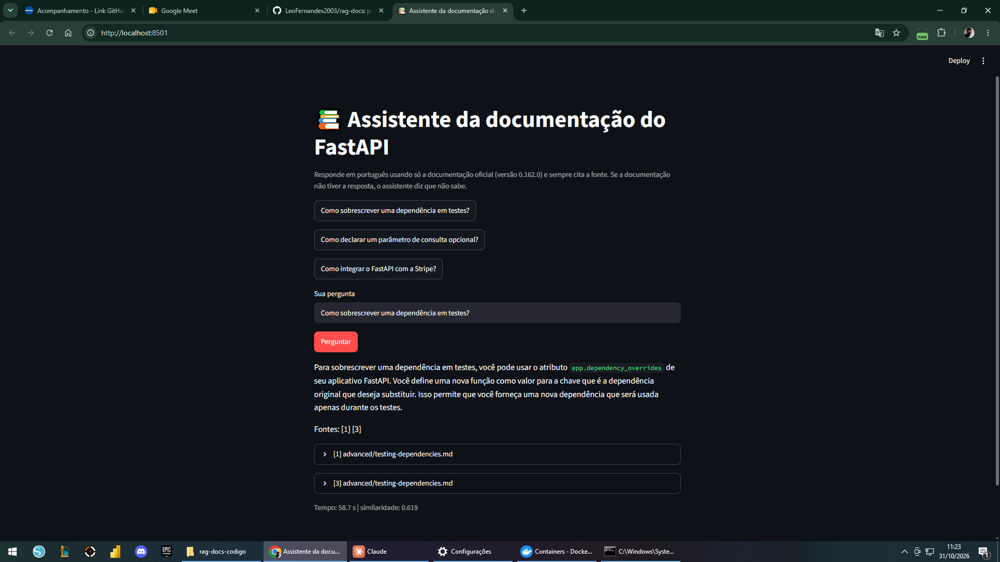
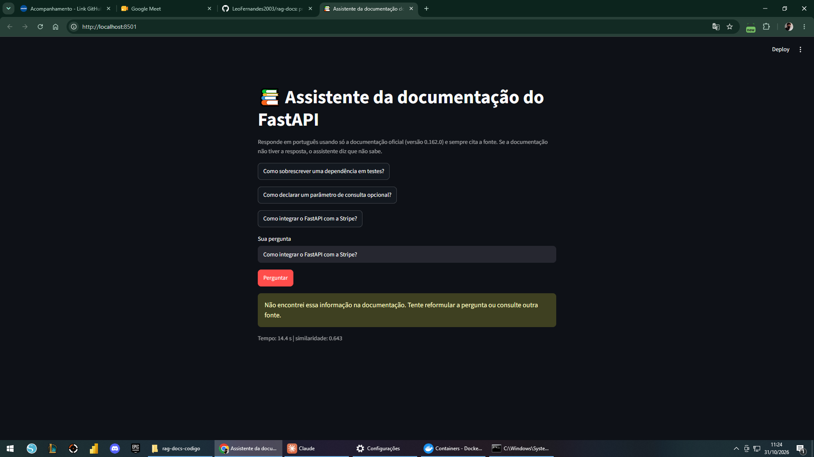

# 9. Manual do usuário

## Abrir a interface

1. Suba o projeto (veja [instalacao.md](instalacao.md)) e espere o terminal terminar de preparar tudo.
2. Abra o navegador em http://localhost:8501.

## Fazer uma pergunta

1. Na página aparecem três botões com perguntas de exemplo. Clique em um deles para preencher a caixa, ou escreva a sua pergunta em português na caixa **Sua pergunta**.
2. Clique em **Perguntar**. Aparece a mensagem "Buscando na documentação e escrevendo a resposta...". A primeira resposta pode demorar mais, porque o modelo está carregando; depois costuma levar de 15 a 60 segundos.
3. Leia a resposta. Ela vem com números entre colchetes, como [1] e [3].
4. Abaixo da resposta há uma caixa para cada fonte, com o número e o nome do arquivo (por exemplo, `[1] tutorial/first-steps.md`). Clique para abrir e ler o trecho da documentação de onde veio a resposta.
5. Na última linha aparecem o tempo gasto e a nota de similaridade, que é só informativa.

*Figura 1. Resposta com fontes [1] e [3] para "Como sobrescrever uma dependência em testes?" (captura de 31/10/2026).*

## Quando o sistema recusa

Se a resposta não estiver na documentação do FastAPI, aparece um aviso amarelo: "Não encontrei essa informação na documentação. Tente reformular a pergunta ou consulte outra fonte." Exemplo: "Como integrar com a Stripe?". Isso é o comportamento esperado.

*Figura 2. Recusa para "Como integrar o FastAPI com a Stripe?" (captura de 31/10/2026).*

Se você acha que a resposta deveria existir, reescreva a pergunta com outras palavras ou mais detalhes e tente de novo.

Se a resposta aparecer sem nenhuma fonte, a interface mostra o aviso "esta resposta não citou nenhum trecho". Nesse caso, confira na documentação oficial.

## Mensagens de erro

| Mensagem | O que fazer |
| --- | --- |
| "Não consegui falar com a API" | Espere o terminal terminar de preparar o ambiente e tente de novo; veja `docker compose logs api` |
| Erro de serviço indisponível (503) | Ollama ou Qdrant ainda estão subindo, ou o índice não foi criado; veja `docker compose logs setup` |
| Pergunta curta ou longa demais | Use de 3 a 500 caracteres |

## Dicas

- Perguntas objetivas sobre um tema funcionam melhor do que perguntas muito amplas.
- Use termos técnicos quando conhecer (por exemplo, `Depends`, `BackgroundTasks`).
- Sempre confira a fonte citada; o modelo é pequeno e pode errar.
