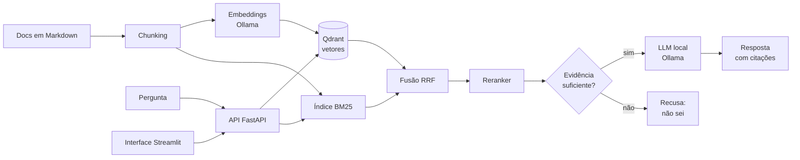

# Proposta técnica (Marco 1): RAG para documentação técnica

Tema 4 · Autor: Leonardo Costa Fernandes · 24/10/2026

## 1. Problema

Documentações técnicas grandes são difíceis de consultar: a busca por palavras-chave perde sinônimos, e modelos de linguagem sem acesso à fonte inventam respostas com aparência de certeza. O objetivo é construir um assistente que responda dúvidas sobre uma documentação de código aberto **citando o trecho-fonte** e **recusando** perguntas cuja resposta não está nela, e comparar com números três decisões de projeto: como dividir o texto (chunking), como buscar (densa, lexical ou híbrida) e se vale usar reranking.

**Corpus (proposto):** a documentação do FastAPI (arquivos Markdown, licença MIT), fixada por commit para que os resultados sejam reproduzíveis. As perguntas serão em português sobre a documentação em inglês, o que exige embeddings multilíngues.

## 2. Arquitetura

- **API:** FastAPI. **Interface:** Streamlit. **Vetores:** Qdrant. **Lexical:** BM25 em memória. **Modelos:** Ollama, candidatos iniciais `bge-m3` (embeddings) e `qwen2.5:3b` (geração), sujeitos a teste no hardware disponível (GPU AMD RX 580 sem suporte oficial esperado do Ollama; o plano é que tudo funcione em CPU).
- Tudo roda localmente, com `docker compose up` e custo zero.

## 3. Métricas de sucesso

Definidas antes do código. Os 50 casos de teste são 40 perguntas com resposta e 10 sem resposta na documentação, escritos antes de qualquer ajuste, divididos em 20 de desenvolvimento (para ajustar) e 30 de teste (usados só na avaliação final).

| Métrica | Como mede | Meta inicial |
| --- | --- | --- |
| Recall@5 | O trecho-fonte esperado está entre os 5 recuperados | ≥ 0,80 |
| Fundamentação | Respostas apoiadas pelo trecho citado (amostra conferida à mão) | ≥ 0,85 |
| Recusa correta | Perguntas sem resposta que o sistema recusa | ≥ 0,80 |
| Recusa indevida | Perguntas com resposta que o sistema recusa | ≤ 0,15 |
| Latência | Tempo por pergunta, em CPU (apenas reportada) | — |

As metas são ponto de partida e podem ser revistas depois do baseline, com justificativa registrada.

## 4. Avaliação experimental

- **Baseline:** chunks de tamanho fixo, busca densa apenas, sem reranker.
- **Comparações:** chunking (tamanho fixo, tamanho fixo com sobreposição, por cabeçalhos Markdown) × busca (densa, BM25, híbrida com RRF) × reranker (sem, com).
- **Alucinação:** análise dos casos em que a resposta não é sustentada pela fonte e da correção aplicada.
- Scripts em `eval/`, com um comando que regera as tabelas.

## 5. Plano

| Marco | Entrega |
| --- | --- |
| 24/10 | Proposta, repositório e CI com um teste (este marco) |
| até 31/10 | Corpus fixado, 50 perguntas escritas, ingestão com chunking de baseline |
| 07/11 | Protótipo ponta a ponta: busca densa, resposta com citação, API, interface simples, testes e Docker |
| 14/11 | MVP: BM25, híbrida, reranker e recusa; protocolo de avaliação; introdução, referencial teórico e metodologia |
| 21/11 | Experimentos concluídos, análise de alucinação, documentação técnica, evidências e rascunho do trabalho |
| 28/11 | Demonstração em aula |
| 30/11 a 02/12 | Tag `v1.0`, vídeo, PDF ABNT e envio |

## 6. Riscos

- **Hardware:** modelos de 3B em CPU são lentos; mitigação: modelos pequenos e avaliação em lote durante a noite.
- **Qualidade dos modelos pequenos** como gerador e como juiz de fundamentação; mitigação: conferência manual em amostra.
- **Projeto individual** com escopo de grupo; mitigação: o plano corta primeiro a interface e o reranker, nunca a avaliação.
